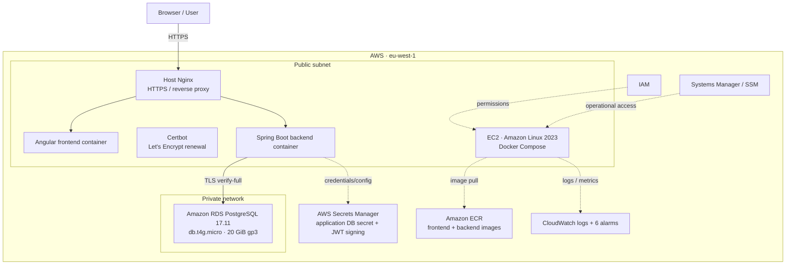

# TaskFlow — AWS Deployment Case Study

**Portfolio case study | Historical deployment | AWS eu-west-1 (Ireland)**

> Status: AWS environment intentionally dismantled. This document describes the historical deployment and its verified characteristics; it does not claim that the infrastructure is currently running or that the entire deployment is reproducible from Terraform.

## 1. Project overview

TaskFlow is a web application built with Angular, Spring Boot and PostgreSQL. It was deployed on AWS as a practical cloud project, with containerized frontend and backend, a public HTTPS entry point, and a managed PostgreSQL database in a private network.

The deployment was used to exercise application delivery, container operation, database connectivity, secrets management, operational access and monitoring. The AWS resources were subsequently removed to avoid ongoing infrastructure costs. The deployment described here is historical: it is evidence of work performed, not a currently available environment.

Repository: https://github.com/JacopoCasanova98/taskflow

## 2. Historical architecture

### Components

| Layer | Historical implementation |
|---|---|
| Compute | EC2 `t3.small`, Amazon Linux 2023 |
| Application runtime | Docker Compose on EC2 |
| Frontend | Angular container |
| Backend | Spring Boot container |
| Entry point | Host Nginx reverse proxy |
| HTTPS | Let's Encrypt / Certbot, systemd renewal timer |
| Database | RDS PostgreSQL 17.11, `db.t4g.micro`, 20 GiB encrypted gp3 |
| Database network | RDS in private network |
| Images | ECR backend and frontend repositories |
| Secrets | AWS Secrets Manager |
| Operations | IAM and Systems Manager / SSM |
| Observability | CloudWatch logs and 6 alarms |
| Schema | Flyway migrations V1–V6 |
| Database security | TLS `verify-full`; application DB user with reduced privileges |

## 3. Delivery and verification evidence

The deployment was historically tested by the project owner:
- HTTPS was verified as working.
- A board was created and remained persisted after page refresh.
- The application was exercised end-to-end.
- GitHub Actions CI was subsequently verified green on the merged `main` commit `983ac56dc11669b6e09862786092f68f73b8a9af` (run [#40580944443](https://github.com/JacopoCasanova98/taskflow/actions/runs/40580944443)) and on the Terraform feature commit `5b2d2b1d1b60e9cb37b147ffeae42c6b876af65c` (run [#40581585921](https://github.com/JacopoCasanova98/taskflow/actions/runs/40581585921)). These are CI/validation results, not deployment runs.
- Docker image identifiers recorded for the historical deployment:

| Image | Historical identifier |
|---|---|
| Deployment tag | `20261026-112559-6d68537` |
| Backend digest | `sha256:1a20b6a9a15c2d51c3e568277a20797f41d26883d36c40b698f69d80b6084d64` |
| Frontend digest | `sha256:e23bd381ac20ac5c6b52c565576c913b6ef888e980d0f1822aaf0b35c38b6145` |

These identifiers are historical evidence, not proof that the images or AWS resources remain available.

### Deployment flow (historical, high-level)

The running environment used the following operational sequence; this is a summary of the deployed setup, not a claim that one IaC command recreated every resource:

1. Provision the EC2 application host, VPC/networking and private RDS PostgreSQL instance in `eu-west-1`.
2. Publish the frontend and backend container images to their ECR repositories, using the recorded deployment tag and image digests above.
3. Configure the EC2 runtime with Docker Compose, the application configuration and access to the required Secrets Manager values through IAM.
4. Configure host Nginx as the public HTTPS reverse proxy, with Certbot and a systemd timer for certificate renewal.
5. Start the frontend/backend containers and run Flyway migrations V1–V6 against RDS, with PostgreSQL TLS certificate verification (`verify-full`).
6. Verify HTTPS reachability, core application workflows and persistence after refresh; use CloudWatch logs/alarms and SSM as operational tools.

The available evidence confirms the environment and smoke-test outcomes, but does not establish a fully automated, one-command recreation procedure.
## 4. Engineering decisions and trade-offs

### EC2 + Docker Compose
A single EC2 host ran the frontend and backend containers. This made the deployment architecture straightforward to operate and suitable for a compact learning project.

**Trade-off:** it was a single-host design, without high availability. A host failure could interrupt the application.

### RDS in a private network
The database was not exposed as a public application endpoint. The backend connected using TLS certificate verification (`verify-full`).

**Trade-off:** the deployment did not demonstrate multi-AZ database resilience or a verified backup/restore procedure. Automated RDS backups were not enabled in the historical configuration.

### HTTPS at host Nginx
Nginx provided the HTTPS entry point and reverse proxy. Certbot and a systemd renewal timer handled certificate renewal.

**Trade-off:** HTTPS was served directly from the EC2 host's public IP. The architecture did not use an Application Load Balancer, Route 53, or ACM.

### Secrets and operational access
Application secrets were kept in Secrets Manager rather than embedded in application source. Systems Manager/SSM was used for operational access.

**Trade-off:** this is evidence of a basic secrets and operations setup, not a claim of a complete production-grade security posture.

### Infrastructure as Code
The repository contains Terraform reference configuration and a CI quality check. The historical AWS deployment should **not** be described as fully reproducible from Terraform unless a resource-by-resource deployment path is independently demonstrated. The Terraform workflow validates configuration; it does not provision AWS resources.

## 5. Known limitations

The following limitations are part of the honest project story:

- Single EC2 host; no high availability.
- No ALB, Route 53 or ACM.
- RDS automated backups were not enabled.
- ECR scan-on-push was not active.
- The complete historical AWS deployment was not proven to be reproducible solely through the repository's Terraform.
- The application is no longer hosted on the AWS environment.
- The historical deployment did not establish a production SLA or disaster-recovery capability.

## 6. Teardown and cost posture

AWS resources were intentionally dismantled after the learning deployment:
- EC2 instance terminated.
- RDS database removed.
- EBS volume removed.
- ECR repositories removed.
- CloudWatch alarms and log groups removed.
- Network resources and VPC removed.
- AWS-managed KMS keys associated with service encryption were retained; no attempt was made to delete AWS-managed keys.
- Two Secrets Manager secrets were scheduled for deletion with the standard recovery window. AWS documents that scheduled-for-deletion secrets are inaccessible and are not charged during that recovery window ([AWS deletion guidance](https://docs.aws.amazon.com/secretsmanager/latest/userguide/manage_delete-secret.html)). The 2026-10-28 metadata check returned a `DeletedDate` that conflicts with the earlier recorded November 3 estimate; permanent deletion is therefore not claimed here, and the date should be confirmed in the console.

This is a resource teardown record, not a guarantee that the entire AWS account has zero cost. A read-only Cost Explorer check on 2026-10-28 reported $0.00 unblended cost for September 2026 and approximately $0.00 for October 1–28 (reported month-to-date total: −$0.000000026 USD). Both periods were marked `Estimated`; Cost Explorer data can lag and the October result is not a final settled bill. A final review of the settled bill remains prudent.

## 7. What I would improve for a production-oriented version

1. Add an ALB and a domain with managed TLS where justified.
2. Add a documented RDS backup and restore test.
3. Define availability and recovery requirements before choosing single-AZ or multi-AZ.
4. Enable ECR image scanning and define image-retention policy.
5. Make infrastructure deployment reproducible with reviewed Terraform modules and environment-specific configuration.
6. Add deployment rollback and health-check strategy.
7. Review IAM permissions and secret rotation requirements.
8. Add cost estimates and an explicit cleanup procedure.

These are proposed improvements, not features already implemented.

## 8. Interview pitch (draft)

> I built and deployed TaskFlow, an Angular and Spring Boot application backed by PostgreSQL, on AWS. The application ran as Docker Compose containers on an EC2 instance, with Nginx handling HTTPS and reverse proxying, and RDS PostgreSQL kept in a private network. I used ECR for images, Secrets Manager for application secrets, SSM for operational access, and CloudWatch for logs and alarms. I also configured TLS verification for the database connection and Flyway migrations.
>
> The project gave me hands-on experience connecting application development with cloud deployment and operations. I also understand its limits: it was a single-host deployment, without high availability or automated database backups, and I would not present the Terraform validation pipeline as a complete infrastructure deployment. The next production-oriented improvements would be backup/restore validation, a more resilient ingress and compute architecture, and reproducible infrastructure deployment.

## 9. Evidence and follow-up

- [x] Historical architecture documented with a Mermaid diagram in this case study.
- [x] README and AWS reference-architecture links included in the integration change set.
- [x] Terraform quality workflow and merge status verified: PR #14 merged; successful feature and `main` CI runs on 2026-10-27.
- [x] Read-only Cost Explorer check completed on 2026-10-28; September and October month-to-date were approximately $0, with data still marked estimated.
- [x] Regional checks across all 18 enabled regions found no EC2 instances, RDS instances/clusters, EBS volumes/snapshots, Elastic IPs, NAT Gateways, classic/v2 load balancers, VPC endpoints, ECR repositories, Lambda functions, or ECS/EKS clusters.
- [x] Global checks found no S3 buckets, CloudFront distributions, or Route 53 hosted zones; an unfiltered CloudFormation stack listing returned no stack summaries in `eu-west-1`.
- [ ] Confirm the current Secrets Manager deletion metadata in the AWS console; the 2026-10-28 `DeletedDate` response conflicted with the earlier recorded estimate. Do not retrieve or publish secret values.
- [ ] Review the final settled billing data after Cost Explorer's normal reporting delay; the October month-to-date amount is only an estimate.
- [ ] Add a screenshot of the historical HTTPS application only if a genuine, safe capture exists; do not fabricate or reconstruct evidence.
- [ ] Review evidence before publishing; remove account identifiers, public IPs, secrets, tokens or sensitive configuration.
---
**Portfolio wording rule:** describe what was actually deployed and tested; label proposed improvements as future work; never claim current availability or full Terraform reproducibility without evidence.
